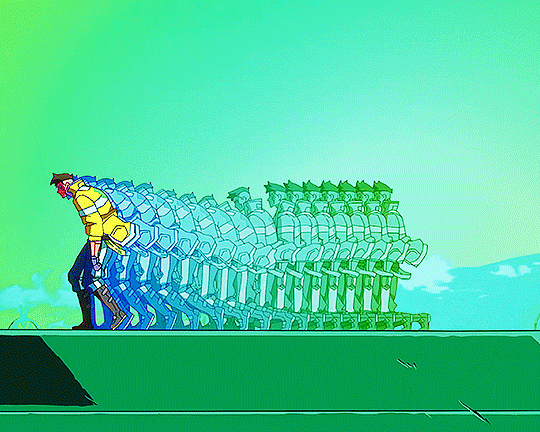

<div align="center">


<br/>



<br/><br/>

<a href="https://github.com/Raneim-gif">
  
</a>
<a href="https://www.linkedin.com/in/daniel-zaitsau-514bb0440/">
  
</a>
<a href="mailto:danielzaitsau32@gmail.com">
  
</a>

</div>

---

## `01 // ABOUT ME`

```text
> INITIALIZING QA PROFILE...
> ROLE: JUNIOR QA TESTER
> SPECIALIZATION: MANUAL TESTING
> OBJECTIVE: IMPROVE SOFTWARE QUALITY
> STATUS: QA PORTFOLIO // ACTIVE
```

I'm a **Junior QA Tester** focused on manual testing, test case design, test documentation, and bug reporting.

I work on practical testing projects to demonstrate my approach to software quality, identify defects, and evaluate web application functionality.

**Core areas:** Manual QA · Test Scenarios · Test Cases · Bug Reporting · Jira

---

## `02 // TECH STACK`

<div align="center">

### `TESTING & QA`


### `DEVELOPMENT & DATA`


</div>

---

## `03 // FEATURED PROJECTS`

<table>
<tr>
<td width="50%" valign="top">

### 🔹 PHPTravels — Login Testing

Manual testing of login functionality.

- Negative test scenarios
- Invalid credentials
- Empty fields
- Authentication checks

<a href="https://github.com/Raneim-gif/phptravels-login-manual-testing-pl">
  
</a>

</td>
<td width="50%" valign="top">

### 🔹 Maxi ZOO — Manual QA

Testing documentation for the Maxi ZOO website.

- Test plan
- Test scenarios
- Login and search
- Navigation and store locator

<a href="https://github.com/Raneim-gif/maxi-zoo-manual-testing-pl">
  
</a>

</td>
</tr>
<tr>
<td width="50%" valign="top">

### 🔹 Test Cases — QA Portfolio

A collection of manual testing documentation for web applications.

- Test cases
- Test scenarios
- Testing documentation

<a href="https://github.com/Raneim-gif/Test-Cases">
  
</a>

</td>
<td width="50%" valign="top">

### 🔹 Character Card — HTML & CSS

A personal character card inspired by RPG and trading card designs.

- HTML structure
- CSS styling
- UI design

<a href="https://github.com/Raneim-gif/personal-character-card">
  
</a>

</td>
</tr>
</table>

---

## `04 // GITHUB STATISTICS`

<div align="center">


</div>

---

## `05 // CONNECT`

<div align="center">

<a href="https://github.com/Raneim-gif">
  
</a>

<a href="https://www.linkedin.com/in/daniel-zaitsau-514bb0440/">
  
</a>

<a href="mailto:danielzaitsau32@gmail.com">
  
</a>

<br/><br/>

```text
[ SYSTEM MESSAGE ]

QUALITY IS NOT AN ACCIDENT.
EVERY BUG IS A CLUE.
EVERY TEST IS A STEP FORWARD.
```

</div>


